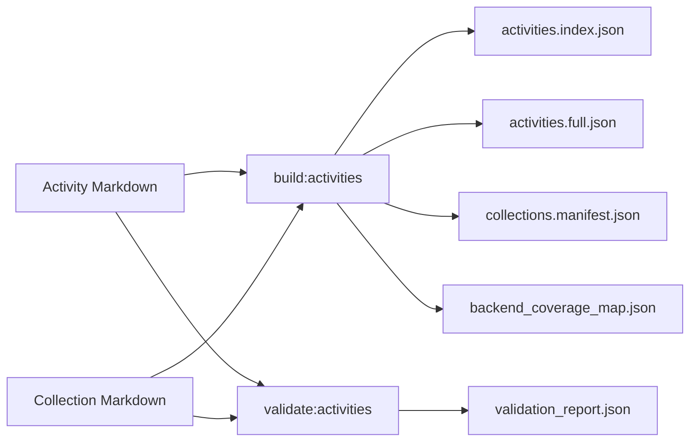

# Curiosity OS — Project Blueprint

This guide explains the application as it exists in the repository. It distinguishes working browse surfaces from older or unfinished code so that the architecture is useful for learning without implying every planned workflow is available.

## Contents

- [Purpose and learning experience](#purpose-and-learning-experience)
- [Maturity and implemented surfaces](#maturity-and-implemented-surfaces)
- [Technology fundamentals](#technology-fundamentals)
- [Repository map](#repository-map)
- [Architecture and navigation](#architecture-and-navigation)
- [3D concept map](#3d-concept-map)
- [Activities and content pipeline](#activities-and-content-pipeline)
- [State and data flow](#state-and-data-flow)
- [Design decisions and trade-offs](#design-decisions-and-trade-offs)
- [Setup and operation](#setup-and-operation)
- [Validation and troubleshooting](#validation-and-troubleshooting)
- [Limitations, lessons, and extensions](#limitations-lessons-and-extensions)
- [Source map](#source-map)

## Purpose and learning experience

Curiosity OS is a web portal for exploring reasoning concepts and trying structured learning activities. Its central idea is to combine two ways of learning:

1. **Browse connected ideas.** The Curiosity Verse presents concepts as a navigable 3D graph rather than a linear list.
2. **Try a practical exercise.** The activity library presents authored playbooks with goals, time estimates, materials, facilitation steps, observation cues, and reflection prompts.

The six learning paths on `/paths` group selected activities around themes such as asking better questions, observing before judging, and discussing disagreement constructively. They are curated lists in source code, not adaptive courses: the page does not record completion or calculate progress.

The application contains no configured login, database, analytics SDK, or AI model integration in the reviewed source. Activity text and graph data are repository files. Browser-local state is used for graph visits and for planner/evidence state models. “No tracking” should be read narrowly: the app has no evident application analytics integration; the hosting provider and the browser may have their own logs or behavior.

## Maturity and implemented surfaces

| Surface | Current behavior in source |
|---|---|
| `/` | Animated landing page with an entry to the gateway and a video background component. |
| `/gateway` | Guide page linking to the Curiosity Verse and activity library. |
| `/verse` | Introductory page for the concept map. |
| `/another_point_of_view` | Loads graph, teaching-state, and layout JSON and renders the interactive 3D map. |
| `/activities` | Reads the activity index and collections and renders the library client. |
| `/activities/[slug]` | Renders one activity’s structured detail and playbook content. |
| `/paths` | Shows six source-defined paths and links to matching activity detail pages. |
| `/planner` | Redirects to `/paths`; it is not a functional planner page. |
| `/activities/[slug]/run`, `/run/complete`, and `/runs/[sessionId]/reflect` | Redirect to the activity detail page. The runner and reflection client/source code remain in the repository but these routes do not provide the session workflow. |

This is best described as a **working content-browsing prototype with an interactive 3D map**, alongside an unfinished facilitation workflow. It is not a classroom management service or a complete learning management system.

The previous README listed `https://curiosity-os.vercel.app`. It could not be verified during this review; treat it as an **unverified deployment address**, not as a confirmed live demo.

## Technology fundamentals

| Technology | Role here |
|---|---|
| Next.js App Router | Maps files under `app/` to routes. Server components can read the repository’s local content; files marked `"use client"` run interactive React code in the browser. |
| React and TypeScript | Build the UI as components and describe the expected shape of data. TypeScript types help during development but do not validate arbitrary JSON at runtime. |
| Tailwind CSS | Utility classes are used directly in JSX for layout and styling. Tailwind 4 is configured through the PostCSS integration. |
| Three.js and React Three Fiber | Provide the browser-side 3D rendering foundation. `react-force-graph-3d` supplies graph layout and interaction. |
| Framer Motion | Adds animated transitions to interface elements. |
| `gray-matter` | Splits Markdown files into YAML frontmatter (structured fields) and a Markdown body. |
| `react-markdown` and `remark-gfm` | Render Markdown content in React, including GitHub-Flavored Markdown features. |
| `localStorage` | Persists selected client state for one browser origin on one device. It is not a server database or cross-device sync. |

The app combines server and browser responsibilities. For example, the graph page reads JSON with Node’s `fs` module and passes prepared props to a client component; the WebGL scene and its controls only initialize in the browser.

## Repository map

| Path | Responsibility |
|---|---|
| [`app/`](app/) | Route entry points, root layout, global styles, and route-specific client components. |
| [`app/page.tsx`](app/page.tsx) | Landing experience. |
| [`app/gateway/page.tsx`](app/gateway/page.tsx), [`app/verse/page.tsx`](app/verse/page.tsx) | Explanatory entry pages. |
| [`app/another_point_of_view/page.tsx`](app/another_point_of_view/page.tsx) | Server-side read and join of graph JSON, teaching state, and a selected layout. |
| [`app/activities/`](app/activities/) | Activity library and dynamic detail, run, completion, and reflection routes. |
| [`app/paths/page.tsx`](app/paths/page.tsx) | Six hand-authored lists of activity slugs. |
| [`components/`](components/) | Shared interface, graph, and older workflow components. |
| [`components/UniverseGraph.tsx`](components/UniverseGraph.tsx) | Client-side 3D map, search/directory controls, node details, and local visit markers. |
| [`components/BottomBar.tsx`](components/BottomBar.tsx) | Persistent navigation dock; graph controls dispatch browser custom events. |
| [`lib/activities.ts`](lib/activities.ts) | Reads activity artifacts or falls back to source Markdown; prepares activity detail data. |
| [`lib/schema/universe.ts`](lib/schema/universe.ts) | TypeScript contracts for graph nodes, edges, teaching state, and layouts. |
| [`lib/planner-context.tsx`](lib/planner-context.tsx), [`lib/evidence-context.tsx`](lib/evidence-context.tsx) | Browser-side planner and facilitation state models. |
| [`content/1_another_point_of_view/`](content/1_another_point_of_view/) | Master graph, teaching-state starter data, layouts, validation reports, and schema references. |
| [`content/0_activities/activities/`](content/0_activities/activities/) | 36 authored activity Markdown files. |
| [`content/0_activities/collections/`](content/0_activities/collections/) | 10 authored collection Markdown files. |
| [`scripts/`](scripts/) | Content generation, schema validation, and other development utilities. |
| [`package.json`](package.json) | Dependency manifest and supported npm scripts. |

## Architecture and navigation

The graph data is read by a Next.js route and prepared for a client-rendered force graph. Activity Markdown is read by the activity library helper; when generated artifacts are absent, that helper can parse source Markdown directly. The diagram shows those source-level relationships and the actual navigation redirects:

```mermaid
flowchart TD
  subgraph Graph[Concept map route]
    GJSON[Master universe JSON] --> GPAGE[another_point_of_view page]
    STATE[Teaching state JSON] --> GPAGE
    LAYOUT[Saved layouts JSON] --> GPAGE
    GPAGE --> GRAPH[Client side UniverseGraph]
    GRAPH --> LOCAL[Browser localStorage: visited node IDs]
  end

  subgraph Activities[Activity browsing]
    MD[Activity and collection Markdown] --> HELPER[lib activities helper]
    DIST[Generated JSON artifacts when present] --> HELPER
    HELPER --> LIB[/activities library]
    HELPER --> DETAIL[/activities/:slug detail]
    PATHS[/paths: six curated slug lists] --> DETAIL
  end

  RUN[/activities/:slug/run] -->|redirect| DETAIL
  REFLECT[/activities/:slug/runs/:sessionId/reflect] -->|redirect| DETAIL
  PLANNER[/planner] -->|redirect| PATHS
```

**Navigation:** The root layout supplies global fonts, the bottom navigation dock, and both React context providers. The dock links to Home, Activities, and Verse. While on the map route, it also emits `universe:search`, `universe:random`, and `universe:reset` custom events; `UniverseGraph` listens for those events. This is a lightweight component-to-component bridge using the browser event system.

The `/planner` redirect is particularly easy to misread: it lands on the curated learning paths page, not on the `PlannerClient` component. Similarly, a `RunModeClient` component and reflection-related components exist, but the current route entry files redirect away from them.

## 3D concept map

The checked-in master universe JSON contains **147 nodes and 381 edges**; its metadata repeats those counts. The teaching-state starter has 147 records, and the layout file contains four named layouts. These are data counts, not claims about learner outcomes.

The map page in [`app/another_point_of_view/page.tsx`](app/another_point_of_view/page.tsx) performs these steps:

1. Reads `master_universe_v1.json`, `teaching_state_v1_starter.json`, and `universe_layouts_v1_starter.json` using `fs`.
2. Builds a `Map` from `node_id` to teaching-state record for fast lookup.
3. Attaches each node’s state and its incident edges (edges whose `from` or `to` match the node ID).
4. Converts edge endpoints from `{ from, to }` to the `{ source, target }` shape expected by the graph component.
5. Selects the `overview-galaxy` layout when present, otherwise the first layout, and passes the result to `UniverseGraph`.

The server joins state by ID in expected O(n + s) time, where `n` is the number of graph nodes and `s` is the number of state records. The current node-to-edge attachment filters all edges once per node, so that part is O(n × e) in this implementation. With 147 nodes and 381 edges this is manageable; building an adjacency index would be a reasonable optimization if the map grows substantially.

In [`components/UniverseGraph.tsx`](components/UniverseGraph.tsx), the graph is dynamically imported with server-side rendering disabled. A mounted guard delays browser-only initialization until after React mounts. The selected layout writes x/y/z coordinates onto matching nodes and copies coordinates into fixed positions (`fx`, `fy`, `fz`) when a layout node is marked `pinned`.

The component supports selecting nodes, searching a directory/list, switching perspective modes, moving the camera to a selected node, choosing random nodes, and resetting the view. Clicking or selecting a node also adds its ID to a `Set` persisted under a namespaced local-storage key. The dock communicates via custom browser events. Relationship types such as `builds_on`, `practiced_in`, `reinforces`, and `embedded_in` are grouped for the selected-node interface.

These map interactions are distinct from a backend learning record: the browser only stores visited IDs. The starter teaching-state file is bundled source data; the reviewed code does not sync teacher edits or state to a server.

## Activities and content pipeline

Each activity is a Markdown file with YAML frontmatter. Frontmatter provides fields used to render filters and detail views: stable ID and slug, title, summary, purpose and mode categories, typical duration, materials, facilitation steps, guidance, pitfalls, and reflection prompts. The Markdown body may also contain detailed facilitation sections.

[`lib/activities.ts`](lib/activities.ts) loads prebuilt files from `content/0_activities/dist/` when available. For activity source fallback it reads `.md` files, parses frontmatter with `gray-matter`, and can derive detailed run steps from the body. The activity detail route then renders structured data and follow-up references. If you edit content, preserve IDs and slugs because paths and follow-up relations refer to them.

The scripts in [`scripts/build-activities.js`](scripts/build-activities.js) and [`scripts/validate-activities.js`](scripts/validate-activities.js) are invoked by npm scripts:



The validator checks required top-level fields and selected enumerated values for activities, plus required fields on collections. It writes a JSON report and exits nonzero if errors are found. It is a focused content check, not a comprehensive JSON Schema validator: for example, the implementation does not validate every nested field’s type or every cross-reference.

The package also has `generate:universe` and `generate-textbook` commands. The former reads JSON files from content directories and generates Markdown notes; it is separate from the runtime graph route, which reads the master JSON directly. No build or content-validation result is claimed by this guide; those commands should be run locally when changing the project.

## State and data flow

The root layout wraps the application with [`PlannerProvider`](lib/planner-context.tsx) and [`EvidenceProvider`](lib/evidence-context.tsx). Each provider loads its initial JSON from `localStorage` after mount, then writes changes back after hydration.

| State | Storage key | Intended / actual role |
|---|---|---|
| Visited graph node IDs | `curiosity_unlocked_curiosity_os_v1` on the graph route | Tracks locally visited nodes and can be reset from the map UI. |
| Saved activities, queue, named sequences | `curiosity_os_planner_v1` | Planner state model exposed by React context; `/planner` currently redirects to `/paths`. |
| Sessions and evidence entries | `curiosity_os_evidence_v1` | Session/evidence state model; runner and reflection routes currently redirect away. |

The intended session data flow can be inferred from the state types and retained runner component: start a session, record timestamped evidence entries while moving through steps, complete the session, then attach reflection and adaptation fields. Since the routes redirect, this should be treated as **implemented state model and retained component code, not a usable end-to-end product flow**.

`localStorage` is origin-specific, browser-specific, and synchronous. Users can lose it by clearing browser data; it is not automatically backed up, shared across devices, or protected from access by scripts running on the same origin. The provider code catches malformed saved JSON during hydration but does not provide an export/import or migration UI.

## Design decisions and trade-offs

- **Repository-authored content:** Markdown and JSON make content reviewable and versionable alongside the UI. The trade-off is that publishing content changes requires a source change and deployment.
- **Local-first state:** No account setup is needed for browser state. The trade-off is no cross-device history, shared classroom roster, or recovery when storage is cleared.
- **Saved 3D layouts:** Coordinates and optional pinned positions make the map spatially repeatable. The trade-off is that layout design and data consistency remain manual concerns.
- **Client-only WebGL:** Deferring graph initialization avoids trying to create a browser WebGL context during server rendering. The graph still has a higher device and graphics cost than a plain list.
- **Feature residue:** Contexts and components for planner, run mode, and reflection remain in source, while their route entry points redirect. This makes repository state easy to overstate; documentation should follow the actual route behavior.

## Setup and operation

### Requirements

- Node.js compatible with the Next.js 16 project and npm.
- A browser with WebGL support for the interactive 3D map.

### Development server

```bash
git clone https://github.com/tharungajula2/curiosity-os.git
cd curiosity-os
npm install
npm run dev
```

Visit `http://localhost:3000`. The package lock is committed; use `npm ci` instead of `npm install` when you need a clean install matching that lockfile.

### Available npm commands

| Command | Purpose |
|---|---|
| `npm run dev` | Start the Next.js development server. |
| `npm run build` | Create a production build. |
| `npm run start` | Serve a production build created by `npm run build`. |
| `npm run lint` | Run ESLint. |
| `npm run validate:activities` | Validate activity and collection Markdown fields and enums. |
| `npm run build:activities` | Generate activity, collection, and coverage JSON artifacts. |
| `npm run generate:universe` | Generate Markdown notes from JSON content files. |
| `npm run generate-textbook` | Run the textbook generation utility. |

There is no `test` script in `package.json`. The repository contains utility files with “test” in their names, but this guide does not treat them as a maintained automated test suite.

## Validation and troubleshooting

- **Activity list appears empty or stale:** Check `content/0_activities/activities/` and whether `content/0_activities/dist/` exists. The loader prefers existing generated JSON; regenerate artifacts with `npm run build:activities` after changing source Markdown.
- **Content schema issue:** Run `npm run validate:activities` and inspect `content/0_activities/dist/validation_report.json`. The validator’s checks are intentionally narrower than a full nested schema validator.
- **Map is blank or WebGL fails:** Try a current browser with WebGL enabled and inspect the browser console. Low-end graphics hardware and mobile browsers may struggle with the 3D graph. The directory/list controls are an alternate way to inspect nodes when the graph is difficult to use.
- **Saved state is missing:** Planner, evidence, and graph state are local to the current browser origin. A different browser, private session, origin, or cleared site data will not share it.
- **Run or reflection URL returns to details:** This is the current route implementation: those pages explicitly redirect to `/activities/[slug]`.
- **Deployment URL unavailable:** The prior Vercel URL was not verifiable during this review. Use the local development instructions until the deployment is independently checked.

## Limitations, lessons, and extensions

### Current limitations

- Run, complete, and reflection route entries redirect to the activity detail page; the intended facilitator loop is unavailable in the current navigation flow.
- `/planner` redirects to `/paths`; a planner context and client component do not make that route a working planner.
- Local storage has no export/import, sync, retention controls, or server-side backup.
- The 3D graph may be demanding on mobile and low-powered devices; the source includes a directory/list view, but there is no separate lightweight graph mode.
- Content is authored in the repository. No in-app authoring or moderation workflow is present.
- The listed hosted demo has not been verified.

### Lessons visible in the implementation

- Content systems need explicit source-of-truth documentation: this repository contains both active graph JSON and an older Markdown-generation path.
- A component or data model is not equivalent to a shipped user workflow; route behavior determines whether a feature is actually reachable.
- Graph identifiers, activity slugs, and local-storage keys are contracts between separate parts of the app. Changing them requires updating references or migrating stored data.
- When state is local-only, clear language about persistence matters as much as the interface itself.

### Possible extensions

1. Reconnect the run and reflection route entries to the retained components, then document and validate the complete flow.
2. Decide whether `/planner` should host the existing planner client or remain a learning-path redirect, then make navigation labels match.
3. Add export/import and a versioned migration strategy for browser state before expanding its use.
4. Add runtime validation for graph JSON, nested activity fields, and cross-references; the current TypeScript types are compile-time descriptions.
5. Add a reduced-motion and lightweight map presentation, and measure graph performance on representative mobile devices.
6. Verify the hosted deployment before restoring a prominent live-demo badge.

These are suggestions, not claims that the work has been completed or tested.

## Source map

- Application routes and redirects: [`app/`](app/), especially [`app/planner/page.tsx`](app/planner/page.tsx), [`app/activities/[slug]/run/page.tsx`](app/activities/%5Bslug%5D/run/page.tsx), and [`app/activities/[slug]/runs/[sessionId]/reflect/page.tsx`](app/activities/%5Bslug%5D/runs/%5BsessionId%5D/reflect/page.tsx).
- Graph preparation and types: [`app/another_point_of_view/page.tsx`](app/another_point_of_view/page.tsx), [`components/UniverseGraph.tsx`](components/UniverseGraph.tsx), and [`lib/schema/universe.ts`](lib/schema/universe.ts).
- Activity loading and content tooling: [`lib/activities.ts`](lib/activities.ts), [`scripts/build-activities.js`](scripts/build-activities.js), and [`scripts/validate-activities.js`](scripts/validate-activities.js).
- Browser state models: [`lib/planner-context.tsx`](lib/planner-context.tsx) and [`lib/evidence-context.tsx`](lib/evidence-context.tsx).
- Graph data: [`master_universe_v1.json`](content/1_another_point_of_view/master_universe_v1.json), [`teaching_state_v1_starter.json`](content/1_another_point_of_view/teaching_state_v1_starter.json), and [`universe_layouts_v1_starter.json`](content/1_another_point_of_view/universe_layouts_v1_starter.json).
